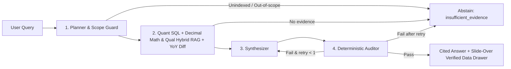

# Autonomous SEC Financial Analyst

> **Hybrid XBRL SQL + Multi-Agent RAG with Deterministic Audit Verification**


-6E40C9?style=flat-square)


A self-hosted, multi-agent financial research system grounded strictly in official **SEC EDGAR `10-K` and `10-Q` filings**. Unlike naive PDF chatbots that misread tables and hallucinate arithmetic, this architecture enforces a strict separation between **LLM reasoning** and **deterministic computation**:

- **Quantitative Metrics & Math** — Normalized **XBRL SQL (`v_latest_xbrl_facts`)** queried through a least-privilege read-only PostgreSQL role (`sec_readonly`) + **`Decimal`-precision Python math** (YoY growth, margins, ratios, FCF — zero LLM mental arithmetic).
- **Qualitative 10-K / 10-Q Retrieval** — Metadata-filtered **Hybrid Search (`pgvector` `BGE-M3` 1024-dim + Postgres FTS/BM25 via RRF)** + **Cross-Encoder Reranking (`BAAI/bge-reranker-v2-m3`)** with parent-paragraph expansion (`≤1,400` chars) and **deterministic YoY section redline diffs**.
- **Deterministic Auditor & Fail-Closed Abstention** — Pure-Python verification gate checking every number and `accession_number` citation against SQL rows, Python math, retrieved excerpts, and YoY diffs (max 1 retry; otherwise strict `insufficient_evidence` abstention).

---

## Architecture



---

## Verified Evaluation Results

Measured live on a local **RTX 3090** (`Qwen3-8B-Q4_K_M` via `llama-server` + `BAAI/bge-m3` + `BAAI/bge-reranker-v2-m3` + PostgreSQL 16) over **9 companies** (`AAPL`, `AMD`, `AMZN`, `GOOGL`, `INTC`, `META`, `MSFT`, `NVDA`, `TSLA`), **18 `10-K` filings (`FY2023–FY2024`)**, **755 XBRL facts**, **4,335 parent paragraphs**, and **14,707 child chunks**:

### 1. Controlled 3-Mode FinanceBench Ablation ([`EVALUATION.md`](EVALUATION.md))
| Configuration | Cases | Numerical Accuracy | Abstention Rate | p50 Latency | p95 Latency |
| :--- | ---: | ---: | ---: | ---: | ---: |
| `naive_rag` (Dense only) | 8 | 42.9% | 0.0% | 0.52s | 11.76s |
| `hybrid_rerank` (Hybrid + Reranker) | 8 | 85.7% | 12.5% | 5.67s | 13.40s |
| **`full_xbrl_auditor` (Full System)** | **8** | **100.0%** | **12.5%** *(1/1)* | **2.75s** | **3.16s** |

### 2. Full 250-Prompt Live Stress Test ([`docs/TEST_PROMPTS.md`](docs/TEST_PROMPTS.md) · [`docs/WEAK_POINTS_REPORT.md`](docs/WEAK_POINTS_REPORT.md))
| Metric | Result |
| :--- | :--- |
| **Overall Pass Rate** | **`238 / 250` (`95.2%`)** *(236/250 raw prior to reclassifying `#248`/`#249` `AMZN`/`INTC` after narrative fix)* |
| **True Abstention Accuracy** | **`48 / 48` (`100.0%`)** *(unindexed tickers/years, out-of-scope, undisclosed data)* |
| **Unverified Numeric Leaks** | **`0`** *(all 12 remaining misses failed closed via the Deterministic Auditor)* |

---

## Quickstart

### 1. Docker Stack
Start PostgreSQL (`pgvector/pgvector:pg16` with `schema.sql` auto-applied) and the FastAPI service:
```bash
docker compose up --build
```
Open `http://localhost:8000` for the streaming analyst UI (with animated centered composer, live 4-stage pipeline timers, slide-over **Verified Data** drawer for `SQL`, `Math`, `Diff`, and `10-K` excerpts, plus `MD`/`JSON` Audit Memo export).

### 2. Local Python Setup & Offline CI
```bash
python -m venv .venv
# Windows: .venv\Scripts\activate  |  Linux/macOS: source .venv/bin/activate
pip install -e ".[dev]"
ruff check src tests
pytest -v
```

### 3. Ingest SEC `10-K` / `10-Q` Filings
Via CLI (supports SEC EDGAR archive pagination for high-volume filers like `JPM`):
```bash
# Annual 10-K filings
python -m sec_analyst.ingestion.pipeline --tickers NVDA AAPL MSFT --years 2023 2024

# Include quarterly 10-Q filings (Q1-Q3)
python -m sec_analyst.ingestion.pipeline --tickers NVDA --years 2024 --include-10q
```
Or on-demand via API / `+ Ingest Ticker` in the UI:
```bash
curl -X POST http://localhost:8000/ingest \
  -H "Content-Type: application/json" \
  -d '{"ticker": "NVDA", "fiscal_years": [2023, 2024], "include_10q": false}'
```

---

## Engineering Guardrails
1. **Zero LLM Math:** Ratios, margins, YoY growth, CAGR, and Free Cash Flow are computed deterministically with `Decimal` precision in [`src/sec_analyst/tools/financial_math.py`](src/sec_analyst/tools/financial_math.py).
2. **Least-Privilege Read-Only SQL:** `validate_readonly_sql` blocks multi-statement injection, DDL/DML, and non-allowlisted tables; Postgres executes under `sec_readonly` with `SET LOCAL TRANSACTION READ ONLY` and a 5s statement timeout.
3. **Fail-Closed Verification:** Out-of-scope queries or unverified numbers return `insufficient_evidence` instead of hallucinating.
4. **Reproducible Offline CI:** All **44** unit, ingestion, retrieval, guardrail, and API contract tests run offline in [`.github/workflows/ci.yml`](.github/workflows/ci.yml) without a GPU or live SEC network calls.

---

## Documentation
- [`EVALUATION.md`](EVALUATION.md) — Controlled FinanceBench ablation results and SEC EDGAR engineering failure analysis.
- [`docs/WEAK_POINTS_REPORT.md`](docs/WEAK_POINTS_REPORT.md) — Iterative failure analysis across 250 test prompts (`Run 1` → `Run 2` → `Full 250 Run 3`).
- [`docs/TEST_PROMPTS.md`](docs/TEST_PROMPTS.md) — Full 250-prompt evaluation dataset (`200` answerable / `50` abstain).
